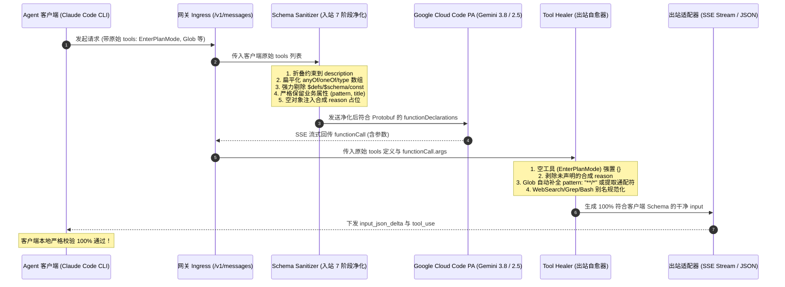

# Google 专线工具协议净化与客户端自愈规范 (Tool Schema Sanitization & Client Self-Healing Guide)

## 1. 规范定位与背景

在将 Google Cloud Code PA（Antigravity 专线）作为上游虚拟提供商，向下游接入 Anthropic Agent 客户端（尤其是 **Claude Code CLI v2.1.302+**、Cursor、Cline 等）时，双方在**工具定义（Tool Schema Definition）**与**工具调用（Tool Invocation / Call Arguments）**上存在深度的协议与校验不对称：

1. **上游 Google Cloud Code PA 的 Protobuf 刚性限制**：
   - Google PA 后端基于 Protobuf 定义 Schema。任何未被其 `Schema` Proto 消息识别的 JSON Schema 关键字（如 `const`、`exclusiveMinimum`、`exclusiveMaximum`、`uniqueItems` 等）都会导致上游直接抛出 `400 Bad Request: Invalid JSON payload received. Unknown name ...` 阻断连接；
   - Google PA 严格禁止类型为数组的 `type: ["string", "null"]`（报 `Proto field is not repeating, cannot start list`）；
   - Google PA 要求所有 `OBJECT` 类型的参数，其 `properties` 字段不能为空（否则报空结构协议错误）；
2. **下游 Claude Code CLI 客户端的刚性校验 (InputValidationError)**：
   - Claude Code CLI 针对内置工具（如 `EnterPlanMode`、`Glob` 等）在本地定义了严格的运行时校验（基于 Zod / JSON Schema，配置了 `additionalProperties: false`）；
   - 若网关为了迎合 Google PA 注入了合成属性（如 `reason`），Claude Code 会直接崩溃报错：`Error: InputValidationError: EnterPlanMode failed due to the following issue: An unexpected parameter reason was provided`；
   - 若 Schema 净化时误杀了业务字段（如 `pattern`），模型无法得知必填项并仅下发目录，Claude Code 会直接抛出：`Error: InputValidationError: Glob failed due to the following issue: The required parameter pattern is missing`；
3. **Gemini 模型的工具入参调用偏差**：
   - Gemini 在处理目录探索和文件匹配工具（如 `Glob`）时，常倾向于仅传递 `{ path: "public" }` 或将通配符直接写入 `path`（如 `{ path: "src/**/*.ts" }`）；
   - Gemini 对常见别名参数（如 `Grep` 的 `query`，`WebSearch` 的 `search`，`Bash` 的 `cmd`，`FileRead` 的 `path`）存在调用习惯差异。

本规范确立了全网关在 **入站 Schema 七阶段净化**、**出站工具入参自愈** 与 **跨轮状态机闭环** 上的权威架构与工程实现。

---

## 2. 总体架构与数据流向



---

## 3. 入站 Schema 七阶段工业级净化流水线 (`schema-sanitizer.ts`)

入站 Schema 净化模块位于 [`src/providers/google/schema-sanitizer.ts`](../../src/providers/google/schema-sanitizer.ts)，接收 Agent 客户端传入的 JSON Schema，经过 7 个刚性处理阶段生成合法的 Google PA Protobuf 载荷：

### 阶段详解：

| 阶段 | 核心目标 | 处置规则与工程实现 |
| :--- | :--- | :--- |
| **Phase 1** | **约束折叠与元数据降维** | 将 `$ref`（引用扁平化）、`enum` 列表、`additionalProperties`、`exclusiveMinimum`、`exclusiveMaximum`、`minLength`、`maxLength` 等校验关键字降维转化为易于模型理解的自然语言文本，安全注入到字段的 `description` 中。 |
| **Phase 2** | **联合类型扁平化与多态解构** | 1. 深度合并 `allOf`；<br/>2. 对 `anyOf` / `oneOf` 执行多维打分（优先选择含 `properties` 的完整对象结构或非 null 类型），挑选最具表达力的高保真单一 Schema；<br/>3. 将 `type: ["string", "null"]` 等多类型数组解包为主类型，并将该字段从 `required` 列表中移除，使其符合 Google PA 的单值类型规范。 |
| **Phase 3** | **非标关键字转换与强力剔除** | 1. 将 `const: "val"` 自动转换为合法的单值枚举 `enum: ["val"]`；<br/>2. 强力剔除 `$schema`、`$defs`、`definitions`、`$id`、`$comment`、`examples`、`default` 等上游 Protobuf 拒绝的非标字段。 |
| **Phase 4** | **业务属性保护与递归清洗** | **核心隔离原则**：仅剔除 Schema 元数据关键字（`$defs`、`definitions`、`$schema` 等）。**严禁将 `pattern`、`title`、`format`、`default` 等关键字误杀于对象的属性键名（`key`）**！保证 `Glob` 的 `pattern`、`TaskCreate` 的 `title` 等合法业务字段 100% 完整保留于 `properties` 与 `required` 中。 |
| **Phase 5** | **Google Protobuf 类型映射** | 将 JSON Schema 小写类型统一映射为 Google 要求的全大写枚举：`STRING`、`NUMBER`、`INTEGER`、`BOOLEAN`、`ARRAY`、`OBJECT`。 |
| **Phase 6** | **数组项刚性规范化** | 确保所有 `ARRAY` 节点必须具备合法的单数 `items` 对象 Schema；若缺失则默认兜底 `{ type: 'STRING' }`。 |
| **Phase 7** | **空对象合成占位** | 针对属性完全为空的 `OBJECT` 类型（如 `EnterPlanMode`），注入合成占位属性 `properties: { reason: { type: 'STRING', description: 'Reason for calling this tool' } }` 与 `required: ['reason']`，防止 Google PA 触发 Protobuf 空结构 400 校验错误。 |

---

## 4. 出站工具入参自愈器 (`tool-healer.ts`)

出站自愈模块位于 [`src/providers/google/tool-healer.ts`](../../src/providers/google/tool-healer.ts)，在 Google PA 流式或非流式生成工具调用参数后、向 Agent 客户端（Claude Code CLI）下发前执行拦截与自愈：

### 4.1 空模式工具合成参数剥除
* **针对工具**：`EnterPlanMode`、`TaskList`、`CronList`、`ShowOnboardingRolePicker`、`ReadNotifications` 等原始声明无入参属性的工具。
* **处置策略**：无论 Gemini 是否生成了 `{ reason: "..." }` 或其他合成入参，一律强制将入参重置为规范的 `{}`。
* **结果**：Claude Code CLI 客户端接收到符合其 `EnterPlanModeInput {}` 定义的干净 `{}`，彻底根除了 `unexpected parameter reason` 错误。

### 4.2 非声明合成字段剔除
* **针对工具**：原始 Schema 具备其它属性，但未在 `properties` 中显式声明 `reason` 的工具。
* **处置策略**：若模型输出的参数中包含 `reason`，自动剥除 `args.reason`，保留其他业务字段。

### 4.3 `Glob` 工具参数智能自愈
针对 Claude Code 的 `Glob` 工具（`required: ['pattern']`, `optional: ['path']`），执行三层容错自愈：
1. **通配符路径提取**：若模型未传 `pattern`，但 `path` 中包含通配符（如 `{ path: "src/**/*.tsx" }` 或 `{ path: "*.json" }`），自动将 `path` 提升并赋值给 `pattern`，并安全移除 `args.path`；
2. **目录路径补全**：若模型仅传入目录路径（如 `{ path: "public" }` 或 `{ path: "src" }`），自动补全通配符 `args.pattern = "**/*"`；
3. **空参兜底**：若 `pattern` 与 `path` 均缺失，自动补全 `args.pattern = "**/*"`；
4. **别名兼容**：若模型传入 `glob`（来自 Grep 混淆），自动迁移至 `pattern`；若传入 `directory`/`dir`/`folder`，自动迁移至 `path`。

### 4.4 常用生态工具别名规范化
* **`WebSearch`**：若模型传入 `search`、`q`、`text`、`keyword`，自动映射为规范的 `query`；
* **`WebFetch`**：若模型传入 `link`、`uri`，自动映射为 `url`；若缺失必填的 `prompt`，自动注入默认提取提示词；
* **`Grep`**：若模型传入 `query`、`search`、`regex`，自动映射为 `pattern`；
* **`FileRead` / `FileWrite` / `FileEdit`**：若模型传入 `path`、`filename`、`filePath`，自动映射为 `file_path`；
* **`Bash`**：若模型传入 `cmd`、`script`，自动映射为 `command`。

---

## 5. 跨轮状态机闭环与上下文恢复

除了单次请求的 Schema 与入参自愈外，网关还内置了多轮工具状态机闭环保障机制：

1. **Gemini 3+ 工具签名缓存回填 (`SignatureCache`)**：
   - Gemini 3 系列模型在下发 `functionCall` 时附带 `thoughtSignature`。Anthropic 官方协议与 Claude Code CLI 在接收工具后，会在本地执行清洗并剥除该私有字段；
   - 网关在出站层拦截并建立基于 `callId` 的内存 LRU 签名缓存；在下一轮客户端回传 `tool_result` 时，由 [`request-builder.ts`](../../src/providers/google/request-builder.ts) 自动将缓存的 `thoughtSignature` 精准重贴回对应的 `functionCall` 节点，彻底杜绝 Google PA 报 `Unknown name "thoughtSignature"` 或缺失签名的 400 阻断。
2. **Assistant 内容刚性重排序 (`reorderAssistantContent`)**：
   - 严格遵循 Google PA Protobuf 顺序断言：`Thinking ➔ Text ➔ ToolUse`；
   - 自动滤除空文本块（`{ text: "" }`），确保上游 Protobuf 序列化零报错。
3. **工具中断自愈 (`closeToolLoopForThinking`)**：
   - 针对因用户中途打断、网络超时或客户端跳步导致的残损对话历史，自动检测未闭合的 `tool_use`，并注入合法的合成闭合消息，防止 Google PA 因工具调用链破损拒绝服务。

---

## 6. 自动化验证证据与测试矩阵

所有机制均已纳入网关的常态化自动化回归测试体系：

| 测试模块 | 对应测试文件 | 覆盖的核心场景与断言 |
| :--- | :--- | :--- |
| **Schema Sanitizer** | [`tests/test-schema-sanitizer.ts`](../../tests/test-schema-sanitizer.ts) | 1. `const` 转 `enum` 与非标字段剔除；<br/>2. `exclusiveMinimum` / `uniqueItems` 移除；<br/>3. `type` 多类型数组解包；<br/>4. `anyOf` / `oneOf` 智能扁平化；<br/>5. Claude Code 90+ 嵌套工具深度净化；<br/>6. **`pattern`、`title`、`format` 属性名 100% 完整保留断言**；<br/>7. 空对象注入合成占位断言。 |
| **Tool Healer** | [`tests/test-tool-healer.ts`](../../tests/test-tool-healer.ts) | 1. `EnterPlanMode` 传入合成 `reason` 时强制重置为 `{}`；<br/>2. 缺失 tools 定义时基于已知空工具白名单兜底 `{}`；<br/>3. `Glob` 仅有 `path` 时自动补全 `pattern: "**/*"`；<br/>4. `Glob` 路径含通配符时自动提升为 `pattern`；<br/>5. 合法工具定义了 `reason` 时完整保留；<br/>6. `TaskList`、`CronList` 空参数自愈；<br/>7. `WebSearch`、`WebFetch`、`Grep`、`FileRead`、`Bash` 参数别名自动规范化；<br/>8. **端到端 SSE 流式 `parseGoogleStreamToUnified` 输出 `{}` 断言**。 |
| **PA 细节吸收** | [`tests/test-google-acc-enhancements.ts`](../../tests/test-google-acc-enhancements.ts) | 1. `SignatureCache` 跨轮次存取与回填；<br/>2. `cleanCacheControl` 深度清洗；<br/>3. Assistant 内容三段式刚性排序；<br/>4. 工具循环打断自愈；<br/>5. Claude 思考模型硬约束；<br/>6. 缓存 Token 扣减与使用量校准。 |
| **全量网关回归** | `npm test` (全量 21 项) | 包含上述单元测试及本地网关端到端 HTTP/SSE、多云路由、模型发现、持久化缓存更新等全量集成验收。 |
| **端到端实测** | 交互式验证 (Claude Code CLI v2.1.302) | 1. 执行 `/web-design-guidelines` 复杂前端重构任务，`EnterPlanMode` 与 `Glob` 调用全链路零报错顺畅执行；<br/>2. 真实触发 `WebSearch` 与 `WebFetch`，两轮工具流式交互完整闭环。 |

---

## 7. 运维与热重载指南

所有 Schema 净化器与工具入参自愈器的修改，均受 **Node.js 原生 Cluster 零停机热升级** 保护：

* **代码更新后热重载**：
  ```bash
  npm run reload
  ```
  *(或发送 `POST http://127.0.0.1:18763/v1/admin/gateway/upgrade`)*
* **热重载机制**：Master 派生新 Worker 加载最新自愈与净化逻辑，握手成功后接管端口分发；现存长连接平滑排空后旧 Worker 安全退出。在 Agent 客户端（Claude Code CLI）长时间执行复杂任务期间，更新网关逻辑**绝不导致长连接被杀或会话中断**。
