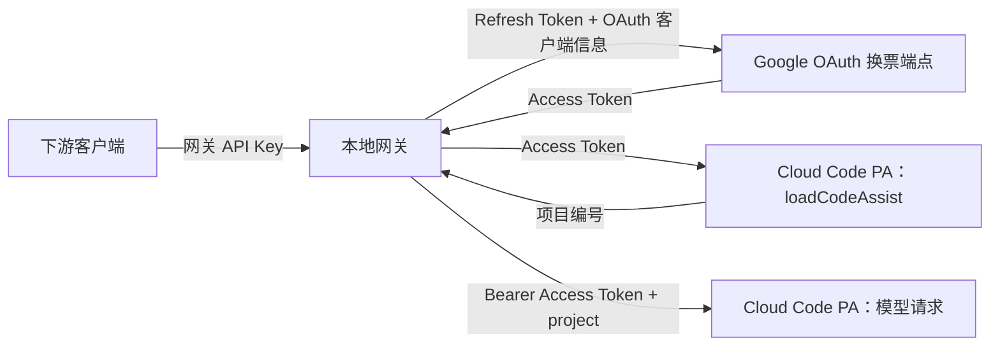

# Google 专线认证与项目编号

**当前实现核对日期：2026-10-09。** 本文说明网关当前的 Google Antigravity / Cloud Code PA 认证链路。Google OAuth 的一般规则以文末官方资料为准；`v1internal` 是内部接口，本文只记录网关实现和已观察到的协议行为，不推断其未公开的计费规则。

## 一次请求经过哪些凭据

| 名称 | 谁提供 / 保存 | 在当前网关中的作用 |
| --- | --- | --- |
| **OAuth 客户端** | 网关代码配置固定的 Google `client_id` 与 `client_secret` | 标识发起授权与换票的应用。Refresh Token 必须与相应的客户端授权匹配；它不是用户的 Google 账号。文档不收录实际客户端凭据。 |
| **Refresh Token** | 用户首次授权后由 Google 发出；网关保存在 `data/google-accounts.json` | 长期换票凭据。每次使用账号时，用它向 Google 换取新的 Access Token。它应按账号凭据保管。 |
| **Access Token** | Google 换票端点返回 | 短期 Bearer 令牌，用于请求 UserInfo 和 Cloud Code PA。网关没有为 Google 账号设置进程内令牌缓存；一次模型请求的上游重试复用同一个令牌。 |
| **Project ID** | `loadCodeAssist` 返回，或 `onboardUser` 开通后返回；组织账号可显式提供 | 放入 PA 模型请求体的 `project` 字段。它不是令牌，也不能单靠填写它获得账号权限；它不是本地代码仓库或网关项目名。 |
| **网关 API Key** | 本地 `config.json` / `GATEWAY_API_KEY` | 下游访问本地网关 API 的凭据。它不会发给 Google，不能替代 Google 的 Access Token。 |

## 首次授权与手动导入

浏览器登录入口是 `npm run account:login` 或管理页 `/google-accounts`。网关在 `127.0.0.1` 的 51121–51126 端口中选择一个临时回调端口，生成 PKCE `S256` challenge 和随机 `state`，向 Google 请求 `cloud-platform`、`userinfo.email` 权限，并设置 `access_type=offline`、`prompt=consent`。浏览器返回授权码后，网关带 `code_verifier` 和同一 OAuth 客户端信息交换令牌；收到 Refresh Token 后，校验账号并保存。当前回调代码**生成并接收 `state`，但尚未比较两者**，因此不能把它视为已完成的回调防伪校验。

手动导入使用 `npm run account:add -- <refresh_token> [label] [projectId]` 或 `POST /v1/admin/google/accounts`。网关会先拿导入的令牌实际换票，再查询账号邮箱和项目编号；只有通过这一过程才添加账号。来自其他 OAuth 客户端的 Refresh Token 不保证能由当前客户端换票。账号文件保存 Refresh Token 明文，没有静态加密。

## 每次模型请求如何换票和取得项目

1. 账号池按当前固定账号优先规则选一个有效账号。`AccountValidator` 用该账号的 Refresh Token、固定 OAuth 客户端信息调用 `https://oauth2.googleapis.com/token`，取得 Access Token；随后用 UserInfo 读取邮箱。网关目前每次请求都重新换票，没有 Google Access Token 缓存或并发单飞锁。
2. 网关以 Access Token 调用 Cloud Code PA 的 `loadCodeAssist`，先试正式端点，失败再试 daily 端点；从响应的 `cloudaicompanionProject` 字符串或对象 `id` 读取项目编号。若响应没有项目而提供 `allowedTiers`，则调用 `onboardUser` 并等待返回的项目编号。组织账号可传入已有项目 ID；当前实现允许在部分成功响应缺少项目时采用这个显式值。
3. 网关把 Access Token 放在上游 `Authorization: Bearer ...` 头，把项目编号放在请求体 `project`。模型发现也使用同一账号取得的 Access Token 和项目编号。无法得到项目编号时报错；`aicode-consumers` 不再是自动填入的固定默认值。旧账号文件若保存了这个值，网关仍会重新向上游发现；上游实际返回该值时可以继续使用。
4. 模型上游发生网络错误、408、429、5xx 时，网关在**同一账号、同一端点**最多尝试 3 次，复用该次 Access Token。换票失败、其他 4xx 和响应流已开始后的错误不按这条规则重试，也不会自动换账号。

对于个人账号，Google 的 [Gemini CLI 认证说明](https://geminicli.com/docs/get-started/authentication/)称通常不要求用户自行配置 Cloud 项目；组织账号可能需要选定已启用服务并授予权限的 Google Cloud 项目。Google 的组织版 [Code Assist 设置说明](https://docs.cloud.google.com/gemini/docs/codeassist/set-up-gemini)明确指出，项目用于管理 API 访问、配额和计费。**这些公开说明不能直接证明 Antigravity 私有 PA 对所有个人订阅的内部配额或计费映射。**

## Refresh Token 失效、迁移与诊断

- 换电脑或换公网 IP 本身不是 Google 文档列出的 Refresh Token 失效条件。当前网关的换票流程没有启用 DPoP，因而持有有效令牌并使用相同 OAuth 客户端信息的另一台电脑，通常也能换票；这不保证后续 Cloud Code PA 一定接受该账号。若令牌签发时启用了 [DPoP 密钥绑定](https://developers.google.com/identity/protocols/oauth2/resources/dpop-adoption)，另一台电脑还必须拥有相应私钥。
- Google 列出的失效原因包括：用户撤销应用授权、连续六个月不用、同一账号与 OAuth 客户端的有效令牌超出上限、限时授权到期、组织管理员限制或会话到期、Google 安全处置。**修改密码导致失效**特指令牌包含 Gmail 权限的情况；当前浏览器登录申请的是 `cloud-platform` 和 `userinfo.email`。外部 OAuth 应用处于 Testing 状态时的七天期限有适用条件，不能假定本项目当前使用的客户端一定受此规则限制。详见 [Google OAuth Refresh Token 说明](https://developers.google.com/identity/protocols/oauth2#expiration)。
- Google 换票返回 `invalid_grant` 时，可能是令牌失效，也可能与组织会话控制有关。当前账号池只要在错误文本中看到 `invalid_grant` 或 `revoked`，就把账号标记为无效；它**尚未区分** Google 的 `error_subtype=invalid_rapt` 会话情形。排查时应先核对原始 Google 错误类型，再决定是否重新登录。[Google 会话控制说明](https://developers.google.com/identity/protocols/oauth2#expiration)
- Access Token 成功换得，只证明 OAuth 换票成功；PA 的项目、权限、账号资格和配额检查仍可能分别失败。例如 PA 403 与 OAuth `invalid_grant` 不是同一故障。

## 本地访问边界与已知问题

网关的 `/v1/*` API 在配置了 `server.apiKey` 时接受 `Authorization: Bearer <网关 Key>` 或 `x-api-key`。`/health` 和管理页 HTML 页面本身无需该 Key；**当前管理页 HTML 直接嵌入配置的网关 Key**，用于页面脚本调用 API，所以仅有 API Key 并不能保护管理页免于同机其他访问者读取。当前 `POST /v1/admin/google/accounts` 的成功响应还会包含完整账号对象，里面有 Refresh Token；认证失败的请求头原文也会写入 JSONL 诊断日志。这些是现有实现中的凭据暴露面，部署时应限制网关、账号文件和日志的访问范围。

Codex 是另一条独立认证链路：它读取本机 `~/.codex/auth.json`，使用其中的登录令牌和自己的换票逻辑。Google 的 Refresh Token、Project ID 与网关 API Key 均不能替代 Codex 登录态；详见[架构主文档的 Codex 认证部分](./多云反向代理网关架构设计方案.md)。

## 实现与验证边界

- 浏览器 OAuth：[onboarding.ts](../../src/providers/google/account-pool/onboarding.ts)；Google 换票及 PA 项目发现：[validator.ts](../../src/providers/google/account-pool/validator.ts)；账号状态：[pool.ts](../../src/providers/google/account-pool/pool.ts)；上游请求：[client.ts](../../src/providers/google/client.ts)；网关入口鉴权：[index.ts](../../src/index.ts)。
- 2026-10-09 的 `npm test` 覆盖项目发现与 `onboardUser` 的模拟响应，网关回归 15/15 包含现有 Google 账号的真实请求；`npm run test:reasoning` 通过。**全新账号的实际开通与异步 `onboardUser` 尚未实测**。跨电脑、跨 IP 与 DPoP 的结论来自 Google 官方 OAuth 文档和当前请求格式，并非本项目多地域实测。
