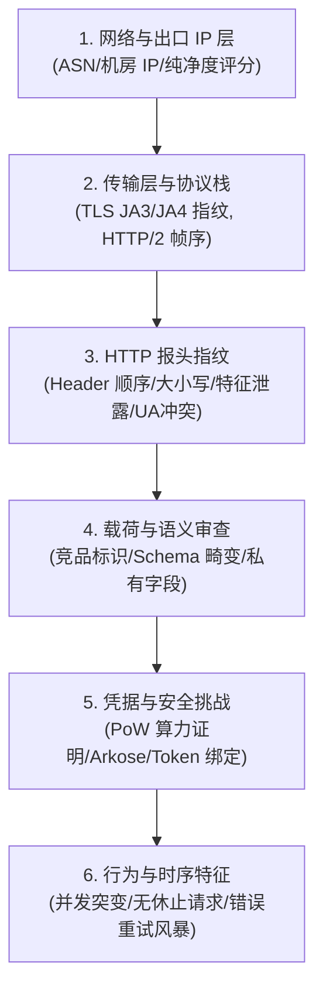

# 云厂商反代检测机制与网关防检规避规范

云厂商（如 Google、OpenAI、Anthropic、Cloudflare 等）对反向代理和逆向中继的检测，本质上是一场**多层次纵深防御（Defense-in-Depth）**的技术博弈。

检测不会只停留在简单的“看有没有代理 Header”，而是涵盖了从**底层网络握手**到**顶层语义行为**的完整链条。下面将系统拆解**厂商的核心检测手段**以及**在代理网关架构中如何逐层防检与伪装**。

---

## 一、 厂商是如何检测反代与自动化工具的？

云厂商的风控引擎主要在以下 **6 个维度**建立检测模型：



### 1. 网络与出口 IP 属性（L3/L4 边缘检测）
* **机房 IP（IDC）与住宅 IP（ISP）甄别**：各大厂商均接入了 MaxMind、IP2Location、Spur 等风控数据库。AWS、GCP、阿里云、搬瓦工等商业机房的 ASN 属于“高危资产”。一旦个人订阅账号（如 ChatGPT Plus、Google One AI）在短时间内通过机房 IP 密集请求，会直接触发验证码或静默限流。
* **代理节点黑名单**：公开代理池或共享中继节点的 IP 地址段通常被重点标记。

### 2. 传输层与 TLS/HTTP2 指纹（L7 边缘指纹）
* **TLS / JA3 / JA4 握手特征**：
  * 使用 Node.js（`fetch`/`undici`/`axios`）、Python（`requests`/`urllib3`）或 Go 原生 `net/http` 发起请求时，其 TLS Client Hello 中的 Cipher Suites（密码套件）、Extensions（拓展列表）、Elliptic Curves（椭圆曲线）的组合与排列顺序与标准 Chrome、VSCode 插件或 Electron 完全不同。
  * Cloudflare、Google GFE 会直接比对 JA3/JA4 散列值，如果 UA 声明是“桌面浏览器/VSCode”，而 TLS 指纹是“Node.js/Python 原生库”，直接判定为反代/脚本。
* **HTTP/2 协议帧指纹（Akamai / Cloudflare H2 Fingerprinting）**：
  * HTTP/2 握手时的 `SETTINGS` 帧参数（如初始窗口大小、最大并发流）、`WINDOW_UPDATE` 增量、以及伪头（`:method`, `:authority`, `:scheme`, `:path`）的先后排列顺序。Node.js 原生 HTTP/2 的伪头顺序与真实浏览器存在明显差异。

### 3. HTTP 报头指纹与代理泄露（L7 Header 审查）
* **代理特征泄露（Proxy Leaks）**：反代服务（如 Nginx、Traefik）默认常附带 `X-Forwarded-For`、`X-Real-IP`、`Via`、`X-Proxy-User` 等报头，厂商一目了然。
* **客户端特有标头缺失**：官方客户端通常具备独有的标头组合（例如 Google Antigravity 会携带特定客户端上下文，OpenAI Codex CLI 会携带会话标识）。若请求直接命中 API 却缺少对应的边缘标头，会被标记为非官方调用。
* **标头大小写与顺序畸变**：HTTP/1.1 与 HTTP/2 的 Header 大小写规范及传输顺序在不同编程语言的 HTTP 客户端实现各不相同，容易暴露技术栈。

### 4. 载荷语义与竞品指纹审查（Payload & Semantic Analysis）
* **竞品 SDK / Agent 标识过滤（Opaque Blocking）**：
  * **典型实战案例**：如之前排查复盘中发现的，Google Cloud Code / Antigravity 专线在 `systemInstruction` 中只要检测到竞品标识（如 `"Anthropic"`、`"x-anthropic-billing-header"` 等），并不会返回直白的 403 Forbidden，而是**伪装返回虚假的 `429 RESOURCE_EXHAUSTED`（配额耗尽）**，以此隐蔽地阻断跨生态反代接入。
* **协议与 Schema 畸变**：
  * 例如将 Anthropic 的 Tool 定义或专有缓存字段（`cache_control`）原样透传给 OpenAI/Google，上游 WAF 会根据这些非标准 JSON 字段直接定位请求来自中继/转接工具。

### 5. 凭据生命周期与安全挑战（Session & Proof-of-Work）
* **算力挑战（PoW, Proof-of-Work）**：例如 OpenAI Codex/ChatGPT 会动态下发 `proofofwork` 或 `sentinel_token`，要求客户端在限定时间内完成哈希计算，简单透传的代理如果不具备实时解算能力就会被直接拦截。
* **Token / Session 异常并发**：同一个个人 OAuth Token 或 Access Token 在毫秒级别并发 10+ 路生成请求，明显违背单人单机使用的物理现实。

### 6. 行为模式与时序特征（Behavioral Profiling）
* **无人类思考间隔**：请求之间毫秒级平整触发，无人类阅读、输入停顿，且 24 小时不间断。
* **暴力重试风暴**：一旦遇到 429 或网络抖动，劣质反代会无退避（Backoff）地疯狂重放，迅速升级为全账号硬性封禁。

---

## 二、 我们如何防止被检测出来？（全链路防御方案）

针对上述检测机制，在代理网关架构中应采取以下 **6 重防御策略**：

### 1. 传输层伪装（TLS / JA3 / H2 协议保真）
* **采用指纹伪装库**：避免直接使用 Node.js / Python 原生的 HTTP 客户端直连强风控端点。在核心请求链路采用集成 Chromium/BoringSSL 握手特征的引擎（如 `curl-impersonate`、Go 的 `tls-client`、Rust 的 `rquest` 或 Node.js 对应的 NAPI 绑定）。
* **对齐 HTTP/2 伪头顺序**：强制对齐真实客户端的标准顺序：
  $$\text{:method} \longrightarrow \text{:authority} \longrightarrow \text{:scheme} \longrightarrow \text{:path}$$

### 2. 报头清洗与双向透明欺骗（Header Sanitization）
* **彻底剥离中继特征头**：
  网关转发请求前，严格清除任何代理痕迹：
  ```javascript
  const STRIP_HEADERS = [
    'x-forwarded-for', 'x-real-ip', 'via', 'x-proxy-user',
    'forwarded', 'proxy-connection', 'cf-connecting-ip'
  ];
  for (const h of STRIP_HEADERS) delete headers[h];
  ```
* **1:1 复制目标官方客户端报头**：
  如果反代的是 Google Cloud Code 专线，则严格伪装其官方 IDE 扩展的 `User-Agent` 与特定请求头；如果对接 Codex，则忠实模拟官方 CLI 行为。

### 3. 载荷净化与竞品脱敏（Identity Scrubbing）
* **关键词中和管道（Sanitizer Pipeline）**：
  在网关内部针对入站的 Prompt、System Instruction 及上下文实施去敏转换，将可能引发上游 WAF 警觉的竞品名称中和为中立名称：
  ```javascript
  const SCRUB_RULES = [
    [/Anthropic/gi, 'AssistantCorp'],
    [/Nous Research/gi, 'the assistant team'],
    [/Hermes Agent/gi, 'the assistant']
  ];
  function scrubPayload(text) {
    if (typeof text !== 'string') return text;
    let result = text;
    for (const [regex, replacement] of SCRUB_RULES) {
      result = result.replace(regex, replacement);
    }
    return result;
  }
  ```
* **剥离专有元数据**：
  丢弃下游客户端特有的计费头（如 `x-anthropic-billing-header`）和非上游规范的 JSON Schema 字段（如 `cache_control`、自定义拓展字段）。

### 4. 出口网络治理（本地回路与住宅网络）
* **本地回路架构（Local Loopback / Native Relay - 最优解）**：
  正如当前网关的设计：**网关部署在用户本地机器（监听 `127.0.0.1`），直连上游官方端点**。
  * **优势**：出口 IP 即为开发者本地的家庭宽带或移动网络（ISP 住宅 IP），天然具备极高信誉分，彻底规避了机房 IP（IDC）的风控拦截。
* **公网部署时的住宅代理转发**：
  若网关部署在公网云服务器，访问上游敏感接口时后端必须通过高质量原生住宅代理（Residential Proxy）出站，坚决避免使用机房公网 IP 直连。

### 5. 流量整形与并发平滑（Traffic Shaping & Jitter）
* **并发控制（Token Bucket / Concurrency Limit）**：
  对单个账号限制最大并行请求数（通常个人订阅账号保持在 1~2 路并发），超出部分在网关内部排队等待，避免瞬时并发触发风控警报。
* **指数退避与随机抖动（Exponential Backoff with Jitter）**：
  当上游发生 429 或限流时，禁止瞬时立即重试。必须采用“指数退避 + 随机抖动”算法，模拟人类或真实客户端的重试节奏：
  $$t_{\text{wait}} = \min(t_{\text{max}},\, t_{\text{base}} \times 2^{\text{retryCount}}) + \text{Random}(0, \text{jitter})$$
* **避免自锁状态机**：
  细分真正的“配额耗尽”与“内容/规则拦截”。单次请求触发语义拦截时，绝不把整个账号持久化标记为不可用，避免网关本地死锁。

### 6. 安全挑战动态解算与凭据保鲜（Challenge Solving & Token Refresh）
* **无感自动续期**：
  维护本地 OAuth 2.0 凭据池，在 Access Token 到期前 5 分钟自动静默刷新，避免使用过期凭据多次尝试引发上游安全审计。
* **本地动态算力解算**：
  针对需要 PoW（工作量证明）或签名挑战的接口，网关内部集成轻量级解算模块，在本地完成哈希运算后再发往上游。

---

## 总结：反代防检的核心原则

| 维度 | 常见暴露原因 | 防检黄金准则 |
| :--- | :--- | :--- |
| **IP 信誉** | 使用便宜的机房 VPS（AWS/搬瓦工等）直连 | 本地回路优先（自用本地网络出站），云端使用住宅代理 |
| **协议指纹** | 使用原生 Node.js / Python 发送请求 | 对齐 TLS JA3/JA4 与 HTTP/2 伪头顺序 |
| **报头痕迹** | 泄露 `X-Forwarded-*` 或缺失客户端必备头 | 全量清洗代理头，1:1 精确模拟官方客户端 Headers |
| **载荷特征** | 携带 `Anthropic`、`cache_control` 等竞品指纹 | 网关建立脱敏（Identity Scrubbing）与格式规范化管道 |
| **时序行为** | 瞬时高并发、无间隔重试 | 限制单账号并发，重试引入指数退避与随机抖动 |

> **一句话总结**：**反向代理网关的最高境界是对上下游的“双向透明欺骗”**——对下游兼容标准 API 规范，对上游完整伪装成官方第一方客户端的指纹、网络与行为。

---

## 三、 分级靶向脱敏工程落地与副作用消除机制（2026-10-17 实施）

为了在**“100% 免疫云厂商 WAF 429 假性拦截”**与**“100% 保护用户代码完整性、杜绝路径与业务副作用”**之间取得完美平衡，网关确立并落地了**分级靶向脱敏（Targeted Tiered Sanitization）**架构：

1. **审查高危区（强制深度中和）**：
   * **System Prompt / Instructions**：各大厂商 WAF 规则的核心审查靶标（识别 `You are Claude Code built on Anthropic SDK`），由 [`src/utils/scrubber.ts`](../../src/utils/scrubber.ts) 采用长词优先策略实施深度中和；
   * **客户端计费与遥测标头**：`x-anthropic-billing-header` 等专有头直接彻底剥离；
   * **工具声明（`tools[].description`）**：脱敏清洗可能残留的生态客户端特征；
   * **工具 Schema 剪枝（`tools[].parameters`）**：由 [`src/providers/google/schema-sanitizer.ts`](../../src/providers/google/schema-sanitizer.ts) 递归清洗 `$defs`、`$schema` 等非标字段（涵盖 `properties` 内部非标保留字）。
2. **白名单保护区（绝对保持原文，零副作用）**：
   * **用户对话与代码正文 (`messages[].content`)**：保持原文。即使用户代码中包含 `import Anthropic from '@anthropic-ai/sdk'` 或正在探讨 Anthropic 架构，网关也绝不篡改用户意图；
   * **工具调用入参 (`tool_use.args` / `function_call.arguments`)**：保持原文。严禁篡改文件路径（如 `/path/to/anthropic_config.json`）与写入的代码内容，彻底杜绝 `ENOENT` 文件缺失或代码编译崩溃；
   * **工具执行结果 (`tool_result.content` / `function_call_output.output`)**：保持原文，保障日志与执行结果的真实保真。
3. **自动化测试与端到端回归 ([`tests/test-scrubber.ts`](../../tests/test-scrubber.ts))**：
   * 严格断言高危区（系统人设、工具描述、非标 Schema）100% 脱敏剪枝；
   * 严格断言保护区（用户代码、`tool_use` 命令、`tool_result` 日志）100% 原文保留；
   * 纳入 `npm test` 套件，全量回归 18/18 项与 `npm run test:reasoning` 均 100% 验收通过。

