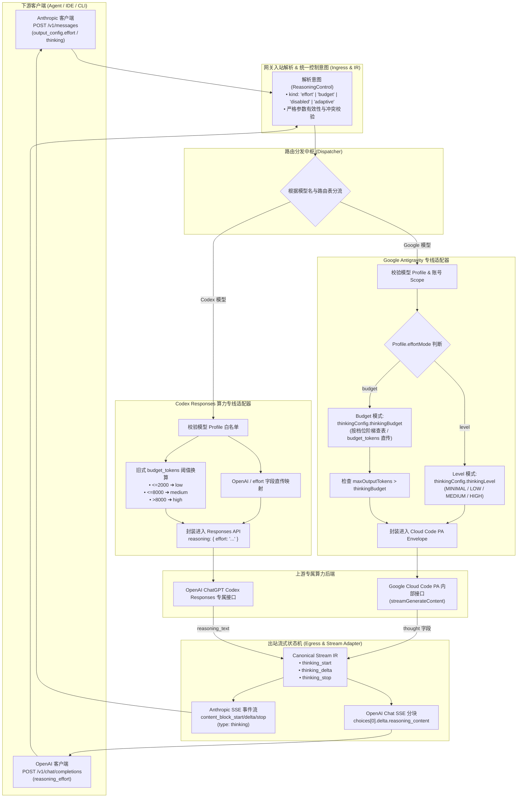

# 多云虚拟模型网关思考强度统一转换机制与协议对齐规范 (Unified Reasoning Effort Architecture)

**状态**：已全量落地实现，并通过真实上游与双协议自动化回归验证。  
**版本**：v1.2 (2026-10-11)  
**相关模块代码**：
* Google 专线推理核心：[`src/providers/google/reasoning.ts`](../../src/providers/google/reasoning.ts) 与 [`src/providers/google/request-builder.ts`](../../src/providers/google/request-builder.ts)
* Codex 专线推理核心：[`src/providers/codex/reasoning.ts`](../../src/providers/codex/reasoning.ts) 与 [`src/providers/codex/request-adapter.ts`](../../src/providers/codex/request-adapter.ts)
* 统一规范中间表示 (IR)：[`src/protocol/ir.ts`](../../src/protocol/ir.ts)
* 协议入站适配：[`src/protocol/ingress.ts`](../../src/protocol/ingress.ts)
* 协议出站投影：[`src/protocol/egress.ts`](../../src/protocol/egress.ts)
* 路由分发器：[`src/router/dispatcher.ts`](../../src/router/dispatcher.ts)

---

## 1. 架构定位与多云抽象

在当代 AI Agent（如 Claude Code CLI、Cursor、Cline、Aider 等）的工作流中，“推理强度 / 思考深度”（Reasoning Effort / Thinking Budget）已成为控制模型推理计算量与解决复杂问题能力的核心维度。

然而，不同下游客户端使用的协议标准迥异，而上游各云厂商的私有接口规范更是碎片化严重：
1. **下游协议标准的分歧**：
   * **Anthropic Messages 现代规范**：采用 `output_config.effort`（离散行为档位：`low`, `medium`, `high` 等）；
   * **Anthropic Messages 旧式规范**：采用 `thinking: { type: "enabled", budget_tokens: 1024 }`（连续精确 Token 预算）；
   * **OpenAI Chat Completions 规范**：采用 `reasoning_effort`（离散档位：`low`, `medium`, `high` 等）。
2. **上游专线协议的断层**：
   * **Google Cloud Code PA 专线**：上游属于 Google 内部 RPC/REST 结构，通过 `generationConfig.thinkingConfig` 控制。其内部模型分裂为两种机制：支持原生大写枚举的 **`thinkingLevel` 模式**（如 `MINIMAL`, `LOW`, `MEDIUM`, `HIGH`）与支持数值 Token 的 **`thinkingBudget` 模式**。此外，Google 还附带有严格的 `maxOutputTokens > thinkingBudget` 约束与账号/项目作用域绑定；
   * **OpenAI Codex Responses 专线**：直连专属后端（`chatgpt.com/backend-api/codex/responses`），上游仅接受 `reasoning: { effort: string }`，完全不接收任何数值型 Token 预算。

本项目作为**多云虚拟模型提供商网关（Virtual Model Gateway）**，建立了一套**入站协议标准化 ➔ 内部控制意图解析 ➔ 上游专线精确转换 ➔ 出站流式思考内容统一投影**的全链路思考强度处理机制。

---

## 2. 端到端系统拓扑



---

## 3. 核心设计原则与防御性哲学

网关在处理思考强度转换时严格遵循三大原则：

### 原则一：不传不干预（Zero Overhead on Default）
* 当下游客户端未显式传入任何思考参数时，网关在组装上游请求时**完全省略思考控制字段**（即不生成 `thinkingConfig` 或 `reasoning`）。
* 网关绝不因为配置中登记了某个默认值就盲目向外部请求强加默认档位，确保完全尊重上游模型原本的默认推理行为。

### 原则二：拒绝假支持与零静默降级（Fail-Fast & Zero Silent Degradation）
* **禁止偷换档位**：若客户端显式指定了 `high`，而目标模型当前仅支持 `low` 和 `medium`，网关**严禁**自动降级为 `medium`。
* **连接建立前立即拦截**：所有能力校验均在向客户端发送 SSE 响应头或向后端发送请求之前完成。遇到未登记能力、非法枚举、冲突参数或输出超限时，统一返回标准 **HTTP 400 JSON 错误**，而不是在流建立后发送流内错误。
* **明确告知可用范围**：400 错误信息中必须明确列出该模型当前已登记支持的档位列表，便于 Agent 调整行为。

### 原则三：真实证据驱动（Evidence-Based Capability Admission）
* Google PA 与 Codex 对具体模型、具体账号甚至不同组织项目的思考支持并非全量开放。
* 网关拒绝根据模型名称“推断”能力。只有通过管理控制台真实探测成功，并将账号 ID、项目编号、端点和时间戳作为证据（`evidence`）保存到档案中的模型与档位，才被视为合法可用。

---

## 4. 入站协议解析与统一控制意图 (Ingress)

在协议入站阶段，网关先将异构的请求参数提取为内部统一的控制意图结构：

```ts
type ReasoningControl =
  | { kind: 'default' }
  | { kind: 'effort'; effort: ReasoningEffort; source: string }
  | { kind: 'budget'; tokens: number; source: string }
  | { kind: 'disabled'; source: string }
  | { kind: 'adaptive'; source: string };
```

### 4.1 字段优先级与决策树

| 请求协议 | 参数条件 | 最终控制意图 | 决策与冲突处理规则 |
| :--- | :--- | :--- | :--- |
| **Anthropic** | 包含 `output_config.effort` | `kind: 'effort'` | **最高优先级**。若同时携带 `thinking.budget_tokens`，仅作为兼容日志记录并被覆盖，不向模型叠加两个上限。 |
| **Anthropic** | `thinking.type === 'disabled'` | `kind: 'disabled'` | 显式要求关闭思考。若同时传了非 `none` 的 effort 则报 HTTP 400 冲突。 |
| **Anthropic** | `thinking.type === 'adaptive'` | `kind: 'adaptive'` | 显式要求自适应模式。若同时传了 `none` effort 则报 HTTP 400 冲突。 |
| **Anthropic** | `thinking.type === 'enabled'` 且携带合法 `budget_tokens` | `kind: 'budget'` | 传统 Token 预算模式。要求 `budget_tokens` 必须为正整数。 |
| **Anthropic** | 未声明上述任何思考字段 | `kind: 'default'` | 保持默认，上游省略控制字段。 |
| **OpenAI** | 包含 `reasoning_effort` | `kind: 'effort'` (或 `none` 对应关闭) | 直接读取枚举字符串并进行白名单校验。 |
| **OpenAI** | 未声明 `reasoning_effort` | `kind: 'default'` | 保持默认，上游省略控制字段。 |

---

## 5. Google 专线转换与硬约束体系 (Google PA)

Google 专线代码位于 [`src/providers/google/reasoning.ts`](../../src/providers/google/reasoning.ts) 与 [`src/providers/google/request-builder.ts`](../../src/providers/google/request-builder.ts)。通过已登记的模型能力档案（`GoogleReasoningProfile`）驱动参数生成：

### 5.1 Level 模式（原生大写枚举）
当模型档案指定 `effortMode: "level"` 时，网关输出原生 Google 枚举：
* `minimal` ➔ `{ "thinkingLevel": "MINIMAL" }`
* `low` ➔ `{ "thinkingLevel": "LOW" }`
* `medium` ➔ `{ "thinkingLevel": "MEDIUM" }`
* `high` ➔ `{ "thinkingLevel": "HIGH" }`

### 5.2 Budget 模式（Token 预算数值）
当模型档案指定 `effortMode: "budget"` 时：
* **由 effort 档位驱动**：根据档案中的 `effortMap` 将档位转换为探测验证过的具体 Token 数值（默认候选阶梯：`minimal: 512`, `low: 2048`, `medium: 8192`, `high: 16384`, `xhigh: 24576`，关闭时 `none: 0`）；
* **由旧式 Anthropic `budget_tokens` 驱动**：检查数值是否落在模型档案核准的 `[budget.min, budget.max]` 闭区间内；
* 最终生成：`{ "thinkingBudget": tokens }`。

### 5.3 关键硬约束
1. **输出上限联动 (`requiresBudgetBelowOutputLimit`)**：
   * Google PA 端点要求：总输出上限（`maxOutputTokens`）必须严格大于思考预算（`thinkingBudget`）。
   * 若客户端请求未指定输出上限，网关会自动注入模型档案登记的 `defaultMaxOutputTokens`。
   * **强校验**：如果客户端显式传入的 `max_tokens`（或 `max_completion_tokens`）$\le$ `thinkingBudget`，网关**立即拒绝并返回 HTTP 400**，绝不越俎代庖替客户端拉大输出限制或悄悄缩减思考预算。
2. **多账号池作用域（Allowed Scopes）约束**：
   * Google 多账号池在分发路由时，会提取该模型该档位通过验证的凭据证据：`evidence[effort]: [{ accountId, projectId, endpoint, checkedAt }]`。
   * 只有匹配该证据作用域的账号与 PA 端点才能被选为执行账号，杜绝未经探测的账号产生上游鉴权拒绝。

---

## 6. Codex 专线转换与阈值分档体系 (Codex Responses)

Codex 专线代码位于 [`src/providers/codex/reasoning.ts`](../../src/providers/codex/reasoning.ts) 与 [`src/providers/codex/request-adapter.ts`](../../src/providers/codex/request-adapter.ts)。上游为专属 Responses 后端，原生接受 `reasoning: { effort: string }`。

### 6.1 OpenAI 入口处理
* 读取 `reasoning_effort`。
* 检查目标模型在 `providers.codex.reasoning.models[model].efforts` 中是否登记支持。
* 校验通过后，直接注入上游 payload：`reasoning: { effort: request.reasoning_effort }`。

### 6.2 Anthropic 入口处理
* **存在 `output_config.effort` 时**：白名单校验后直接作为 Codex `reasoning.effort` 发送；
* **存在旧式 `thinking.budget_tokens` 时（离散化阈值换算）**：
  Codex 上游无法接收具体 Token 预算，网关通过配置的阈值（默认 `lowMaxTokens: 2000`, `mediumMaxTokens: 8000`）进行算法换算：
  $$\text{effort} = \begin{cases} \text{"low"}, & \text{budget\_tokens} \le 2000 \\ \text{"medium"}, & 2000 < \text{budget\_tokens} \le 8000 \\ \text{"high"}, & \text{budget\_tokens} > 8000 \end{cases}$$
  换算后的档位必须经过模型能力白名单校验，若模型不支持该换算档位同样返回 HTTP 400。
* **`thinking.type: "disabled"`** ➔ 映射为 `none` 档位（需模型登记支持）；
* **`thinking.type: "adaptive"`** ➔ 省略上游 `reasoning` 字段，交由模型自适应。

---

## 7. 出站流式状态机与思考内容统一投影 (Egress)

在流式响应阶段（[`src/protocol/egress.ts`](../../src/protocol/egress.ts)），网关将不同上游的思考内容抽象为统一的 Canonical Stream IR 事件：
* `thinking_start`
* `thinking_delta` (`text: string`)
* `thinking_stop`

### 7.1 双下游协议投影矩阵

| Canonical IR 事件 | 上游来源 (Google PA) | 上游来源 (Codex Responses) | 投影到 Anthropic SSE | 投影到 OpenAI Chat SSE |
| :--- | :--- | :--- | :--- | :--- |
| **思考开始** | 首个包含 `part.thought` 的分块 | `response.output_item.added` (`item.type: reasoning`) | 发送 `content_block_start`<br/>`{ type: "thinking" }` | 内部状态切换 |
| **思考增量** | `part.thought` 文本片段 | `response.reasoning_text.delta` | 发送 `content_block_delta`<br/>`{ type: "thinking_delta", thinking: text }` | 发送 SSE 分块<br/>`choices[0].delta.reasoning_content: text` |
| **思考结束** | 后续出现正文或工具块 | `response.output_item.done` / 新 item | 发送 `content_block_stop` | 内部状态重置 |

### 7.2 非流式（Buffered）聚合
当客户端请求 `stream: false` 时，网关在出站层自动收集流式事件：
* 遇到思考块时，若下游是 Anthropic 协议，则在聚合内容中保留思考块或仅在 `thinking` 字段展示；
* 累加计算最终的输入/输出 Token；
* 在所有流块收集完毕后一次性组装为 JSON 响应体返回。

---

## 8. 模型能力探测与元数据暴露 (Admin Probe & Model Hub)

### 8.1 真实探测流程
网关提供统一的管理端探测接口 `POST /v1/admin/models/reasoning-probe`：
1. **Google 专线**：管理员可选择探测 `budget` 模式或 `level` 模式，网关会针对每个启用的账号发送短文本推理，验证 Cloud Code PA 是否返回 HTTP 200 并成功输出；
2. **Codex 专线**：管理员可一键触发全模型批量探测，逐个尝试 `low`、`medium`、`high` 等档位；
3. **审核与热更新**：探测通过后，管理员调用 `PUT /v1/admin/models/reasoning-profile` 将已验证的档位写入 `config.json`，当前运行实例热重载立即生效。

### 8.2 对外暴露元数据 (`GET /v1/models`)
已登记思考能力的模型会在 `/v1/models` 中返回扩展字段，供下游客户端查询识别：
```json
{
  "id": "gemini-2.5-flash",
  "reasoning_efforts": ["low", "medium", "high"],
  "reasoning_control": "budget",
  "reasoning_verification": "pa-request-accepted",
  "supports_thinking_budget": true,
  "supports_thinking_disable": false
}
```

---

## 9. 核心代码索引

| 逻辑环节 | 核心代码实现文件 | 关键函数 / 符号 |
| :--- | :--- | :--- |
| **Google 推理预处理** | [`src/providers/google/reasoning.ts`](../../src/providers/google/reasoning.ts) | `prepareGoogleAnthropicReasoning`<br/>`prepareGoogleOpenAIReasoning`<br/>`validateGoogleReasoningProfile` |
| **Google PA 信封组装** | [`src/providers/google/request-builder.ts`](../../src/providers/google/request-builder.ts) | `buildGoogleCloudCodePayload` |
| **Google SSE 解析** | [`src/providers/google/sse-parser.ts`](../../src/providers/google/sse-parser.ts) | `parseGoogleStreamToUnified` |
| **Codex 推理预处理** | [`src/providers/codex/reasoning.ts`](../../src/providers/codex/reasoning.ts) | `resolveAnthropicReasoning`<br/>`resolveOpenAIReasoning`<br/>`getCodexReasoningProfile` |
| **Codex 请求组装** | [`src/providers/codex/request-adapter.ts`](../../src/providers/codex/request-adapter.ts) | `CodexRequestAdapter.fromIR` |
| **Codex SSE 解析** | [`src/providers/codex/stream-adapter.ts`](../../src/providers/codex/stream-adapter.ts) | `CodexStreamAdapter.toUnifiedStream` |
| **统一 IR 协议规范** | [`src/protocol/ir.ts`](../../src/protocol/ir.ts) | `GatewayRequestIR`<br/>`GatewayStreamEventIR` |
| **出站 SSE 流投影** | [`src/protocol/egress.ts`](../../src/protocol/egress.ts) | `toAnthropicEventStream`<br/>`toOpenAIChatChunkStream` |
| **路由与分流总控** | [`src/router/dispatcher.ts`](../../src/router/dispatcher.ts) | `Dispatcher.prepareAnthropicReasoning`<br/>`Dispatcher.dispatchAnthropic`<br/>`Dispatcher.dispatchOpenAI` |
