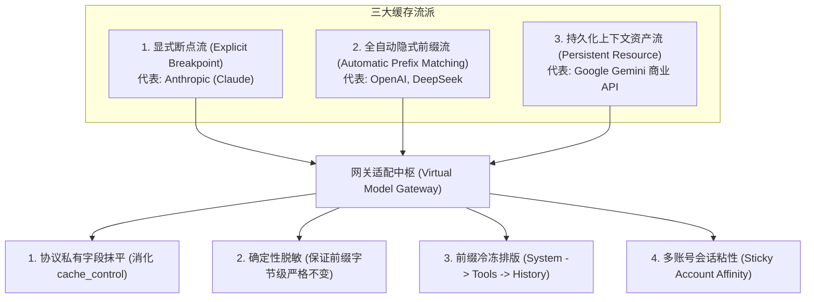

# 多云提示词缓存机制与网关对齐规范 (Prompt Caching Architecture Guide)

> [!NOTE] **规范定位说明**  
> 本文档为多云虚拟模型网关工程的**提示词缓存（Prompt Caching / Context Caching）底层原理与工程适配核心规范**。  
> 深入剖析主流厂商（Anthropic、OpenAI、Google、DeepSeek）在缓存机制上的流派分化与底层技术差异，给出网关在载荷脱敏、协议转换、排版对齐与多账号路由粘性（Sticky Routing）上的工程实践准则。

---

## 1. 缓存对抗全景与三大技术流派

大模型厂商提供的上下文缓存机制，其物理本质是复用服务端 GPU/TPU 显存中的 **注意力键值缓存（KV Cache）**，从而跳过计算密集型的预填充阶段（Prefill），大幅降低首字延迟（TTFT）并降低推理成本。

当前主流大模型厂商在缓存控制权和实现方式上分化为 **三大流派**：



---

## 2. 主流云厂商缓存机制横向对比

| 核心维度 | **Anthropic (Claude)** | **OpenAI (GPT-4o / o1)** | **Google (Gemini / PA)** | **DeepSeek (V3 / R1)** |
| :--- | :--- | :--- | :--- | :--- |
| **触发方式** | **显式打标**<br>客户端必须显式声明 `cache_control` | **全自动透明**<br>无需传参，云端自动识别匹配 | **双模驱动**<br>商业 API 显式创建，内部/PA 自动识别 | **全自动透明**<br>无需传参，自动匹配 |
| **生效门槛** | $\ge 1,024$ tokens<br>(Haiku 为 2,048) | $\ge 1,024$ tokens | 显式通常 $\ge 32,768$ tokens<br>(PA 内部隐式通常 1024) | $\ge 64$ 或 1024 tokens |
| **对齐步长 (Chunk)** | 完全按开发者断点截断 | **128 tokens**<br>(超过 1024 后按 128 整数倍匹配) | 资源整体或内部显存 Page 块 | **64 tokens** 块对齐 |
| **缓存寿命 (TTL)** | **5 分钟**<br>(每次命中重新顺延 5 分钟) | **5 ~ 10 分钟**<br>(按 LRU 算法动态驱逐) | **可自定义**<br>(可设几小时到几天，按存储时长计费) | 动态显存 LRU 驱逐 |
| **写入成本** | **加收 25% 溢价**<br>(首次写入成本高于普通 token) | **完全免费**<br>(写入与普通 Prompt 同价) | **按小时收存储费**<br>($/百万 token/小时) | **完全免费** |
| **命中折扣** | **90% 折扣**<br>(仅付 10% 成本) | **50% 折扣**<br>(半价) | **75% 折扣**<br>(仅付 25% 成本) | **高达 90% 折扣**<br>(低至 0.14 元/百万 token) |

---

## 3. 各流派底层机制深度剖析

### 3.1 显式断点流（Anthropic Claude）
* **原理**：Anthropic 认为只有客户端开发者才知道哪部分内容是不变的。因此单次请求最多允许打 **4 个断点**：
  ```json
  "system": [
    {
      "type": "text",
      "text": "项目全局核心架构规范...",
      "cache_control": { "type": "ephemeral" }
    }
  ]
  ```
* **特点**：
  * **不打标绝不缓存**：哪怕发送 10 万 tokens 的上下文，只要没有 `cache_control`，服务端就不会固化 KV Cache；
  * **单向依赖截断**：必须严格自左向右命中；若断点 1 的内容改变，断点 2、3 即使内容一致也会全盘失效。

### 3.2 自动隐式前缀流（OpenAI & DeepSeek）
* **原理**：客户端完全零侵入。底层推理集群通过 **Radix Tree（基数树）** 或 **前缀哈希表** 自动追踪并复用用户请求的前缀 KV Cache。
* **特点**：
  * **前缀敏感性极高**：只要 Prompt 最开头有 1 个字符不同（例如动态时间戳、动态计费头），整个哈希链条从第 1 个字符开始完全断裂，后面的数万 Token 全部穿透（Cache Miss）；
  * **128 Token 步进对齐**：若相同的前缀长度为 1050 tokens，OpenAI 只会缓存前 1024 tokens；必须达到 $1024 + 128 = 1152$ tokens，才会固化第二块。

### 3.3 持久化上下文资产流（Google Gemini 商业 API）
* **原理**：将大模型缓存做成类似“对象存储”的静态资源：
  1. 调用 `POST /v1beta/cachedContents`，上传超长文档或代码仓库，获取一个句柄 `cachedContents/xyz-890`；
  2. 之后的多次会话直接指定使用该句柄进行推理。
* **特点**：适合超大型固定上下文（$\ge 32k$ tokens）的反复查询，需支付显存存储租金。
* **注**：在 Google Cloud Code PA / Antigravity 专线中，采用的是类似 OpenAI 的**内部自动隐式前缀缓存**。

---

## 4. 网关脱敏与缓存命中的协同设计

在进行防检规避与载荷脱敏时，开发者常担心“清洗文本是否会导致上游缓存击穿”。本网关通过以下机制保证**脱敏与缓存高效命中并存**：

### 4.1 纯函数的绝对确定性（Pure Determinism）
* 缓存命中的核心是**字节与 Token 序列的绝对可重现性**。
* 网关的 `scrubber.ts` 为**无状态纯函数**：
  对于完全相同的入站 System Prompt，每次清洗输出的结果在字节级 100% 恒定一致（每次 `Anthropic` 都必然映射为同一中立字符串）。
* 经 Tokenizer 编码后生成的 Token ID 序列完全恒定，上游计算注意力 KV Cache 时能够精准匹配。

### 4.2 剥离动态标头反而保护了缓存命中
* Claude Code 等客户端在 System 顶部常注入动态计费/遥测头：
  `x-anthropic-billing-header: cc_version=2.1.300.99a; cc_entrypoint=cli;`
* 若原样转发，只要该标头携带微小会话参数变动，就会导致**整个 System Prompt 的起始 Token 发生抖动，直接引发全盘缓存穿透**；
* 网关将其彻底整行剥离，使送入上游的 Prompt 头部完全静态化，反而最大程度保护了缓存命中率。

### 4.3 白名单保护区确保了多轮对话的前缀严格累加
* KV Cache 的匹配机制是**自左向右严格单向累积**。
* 本网关落地**分级靶向脱敏**：
  * 高危区（`systemInstruction`、`tools[].description`）在整个会话中高度静态且锁定；
  * 白名单保护区（前 $N-1$ 轮的 `messages` 历史）**绝对保持原文、分字不改**；
  * 仅在最右侧追加最新的第 $N$ 轮提问。
* 这种“前缀坚固锁定、仅在末尾追加”的拓扑，是上游 KV Cache 算法最容易命中 100% 缓存的完美形态。

### 4.4 外层信封动态参数不入模型 Tokenizer
* 网关在构造 Google PA 请求时，外层信封包含动态追踪 ID（如 `requestId: 'agent-' + uuid`）。
* 该字段处于 RPC 协议信封层，**完全不参与模型上下文的 Token 编码**，对注意力 KV Cache 计算零影响。

---

## 5. 多云网关工程落地守则

为了在跨生态反向代理中最大化缓存效益，网关必须严格遵循以下三条工程准则：

### 准则一：协议私有特性的跨生态抹平
* 下游客户端发送 Anthropic 私有的 `cache_control: {"type": "ephemeral"}` 时，网关在 Ingress 解析为 IR 时识别并消化；
* 转往 Google PA 或 Codex 时，必须将该非标字段剔除，转由上游底层原生的自动前缀缓存承接，杜绝上游报 400 格式错误。

### 准则二：前缀结构的绝对冷冻排版
* 严格保持从静态到动态的排版拓扑：
  $$\text{静态系统指令 (System)} \longrightarrow \text{静态工具声明 (Tools)} \longrightarrow \text{历史消息上下文} \longrightarrow \text{最新提问 (User)}$$
* 严禁在 System 或 Tools 区域插入动态时间戳、随机数或会话临时 ID。

### 准则三：多账号池的会话粘性路由（Sticky Routing Affinity）
* 缓存是缓存在具体的物理计算集群显存上的；
* 在多账号池（`GoogleAccountPool`）中，同一个用户的会话若在账号 A 与账号 B 之间来回漂移轮询，会导致上一次写入的 KV Cache 完全失效；
* **网关必须实施“固定账号优先（Sticky Account）”策略**：只要当前绑定账号未触发限流，同一用户的对话必须持续命中同一个账号与项目端点。

---

## 6. 关联规范与指引
* [**云厂商反代检测机制与网关防检规避规范**](./云厂商反代检测机制与网关防检规避规范.md)：脱敏对抗体系、分级保护区与实测证据。
* [**全能多云反向代理网关架构设计方案**](./多云反向代理网关架构设计方案.md)：网关核心拓扑与路由分流设计。
* [**多云思考强度统一转换与协议对齐规范**](./多云思考强度统一转换与协议对齐规范.md)：思考强度转换与输出上限硬约束。
