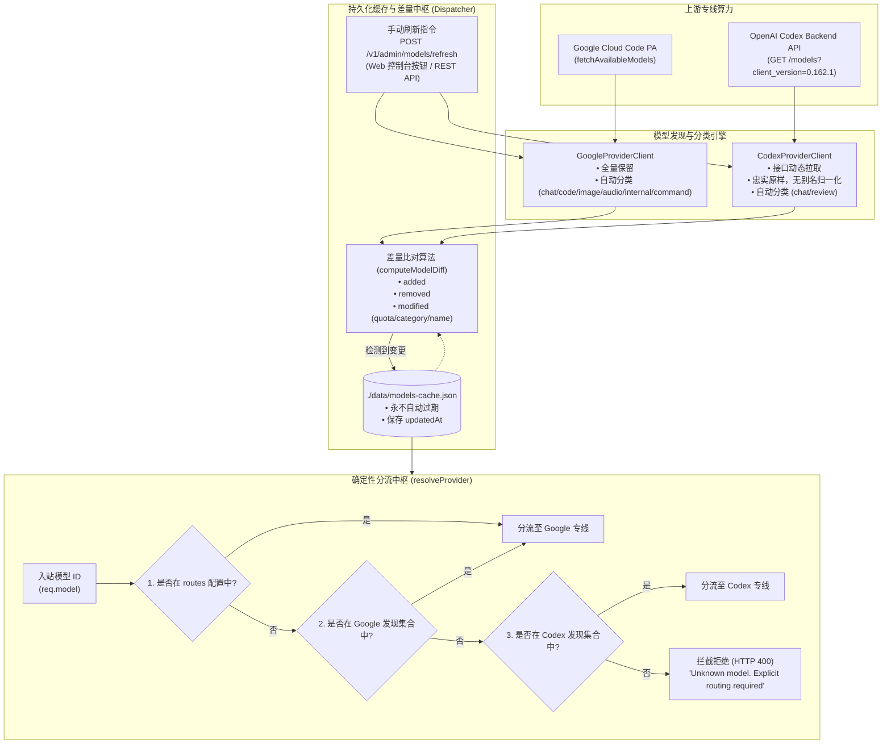

# 模型分类、持久化缓存差量更新与确定性路由改造设计规范

> **更新日期**：2026-10-16  
> **适用版本**：多云虚拟模型提供商网关（Virtual Model Gateway）  
> **关联源码**：[`src/types.ts`](../../src/types.ts)、[`src/providers/google/client.ts`](../../src/providers/google/client.ts)、[`src/providers/codex/client.ts`](../../src/providers/codex/client.ts)、[`src/router/dispatcher.ts`](../../src/router/dispatcher.ts)、[`src/ingress/web.ts`](../../src/ingress/web.ts)  
> **权威接口**：[模型发现 API 文档](../api/模型发现API.md)

---

## 1. 背景与改造动因

早期网关的模型发现与路由调度机制存在以下局限性：
1. **Google 专线暴力过滤**：为了保障下游 Agent（如 Claude Code CLI）能直接对话，旧逻辑过滤掉了内部模型（`isInternal`）、代码补全（Tab 模型）、生图以及音频转录等非对话模型，导致多模态或代码补全算力对上层完全不可见；
2. **Codex 专线别名污染与本地强依赖**：Codex 专线依赖读取本地 `~/.codex/models_cache.json`，并硬编码了 `codex`、`gpt-5-codex` 等别名映射与归一化，既无法反映官方动态发布的最新模型变动，又引入了不必要的隐式转换层；
3. **缓存自动过期与盲目写盘**：旧设计采用 24 小时自动 TTL 或内存缓存，每次启动或刷新时均无差别覆写文件并重置时间戳，缺乏对模型“是否有实质增删改”的感知与差量审计；
4. **启发式路由的隐患**：路由调度使用 `model.includes('claude')`、`model.includes('gpt')` 等关键词启发式推断。当用户请求不规范模型或官方发布新命名格式时，容易发生错误分流或难以排查的非确定性行为。

为此，本改造确立了四大核心原则：
* **模型分类替代过滤**：全量保留上游条目，通过多维元数据赋予明确的 `category`；
* **接口动态直连且无别名**：Codex 直接请求上游 API，不设别名，不作归一化；
* **持久化缓存与手动差量刷新**：缓存永不自动失效，仅在手动触发且上游出现实际条目变动时，才更新时间戳并落盘，同时汇报具体变更字段（Diff Reporting）；
* **绝对确定性路由**：彻底废除关键词/前缀启发推断，仅通过配置显式路由与已发现集合精确匹配，未知模型坚决拦截。

---

## 2. 核心架构与详细设计



---

### 2.1 Google 专线全量保留与分类挂载

Google 专线上游接口 `fetchAvailableModels` 返回的数据包具备丰富的分类标识：
* `tabModelIds: string[]`：代码补全模型；
* `imageGenerationModelIds: string[]`：图像生成模型；
* `audioTranscriptionModelIds: string[]`：语音转录模型；
* `commandModelIds: string[]`：指令类模型；
* `models[id].isInternal: boolean`：内部测试模型。

客户端取消所有硬编码过滤逻辑，按以下规则精准分配 `category`：
```typescript
function categorizeGoogleModel(id: string, meta: GoogleModelMetadata): ModelCategory {
  if (meta.isInternal || id.startsWith('chat_')) return 'internal';
  if (meta.isTabModel || id.startsWith('tab_')) return 'code_completion';
  if (meta.isImageModel) return 'image';
  if (meta.isAudioModel) return 'audio';
  if (meta.isCommandModel) return 'command';
  return 'chat';
}
```
* **效果**：19+ Google 上游模型（包含 `tab_flash_lite_internal`、生图、转录等）全量保留，上层可通过类别筛选按需取用。

---

### 2.2 Codex 专线上游直连与去别名化

1. **直连官方 API**：
   * 发起 `GET https://chatgpt.com/backend-api/codex/models?client_version=0.162.1`；
   * 注意必须携带 `client_version` 查询参数（上游强制校验字段，缺失将报 HTTP 400）；
   * 若无网络或处于离线测试环境，优雅回退至本地 `~/.codex/models_cache.json`。
2. **彻底废除别名与归一化**：
   * 删除客户端与适配器中原有的 `gpt-5-codex`、`codex` 等别名替换映射；
   * 上游下发什么 slug 就忠实登记什么 slug（如 `gpt-6.1-sol`、`gpt-6-astra`、`gpt-reserve`、`codex-auto-review`）；
   * 自动分类规则：以 `review` 结尾的归类为 `review`，其余归类为 `chat`。

---

### 2.3 持久化缓存与差量更新算法 (Diff Reporting)

#### 数据结构与存储位置
持久化于 `./data/models-cache.json`，格式如下：
```json
{
  "updatedAt": "2026-10-16T14:38:03.317Z",
  "google": [
    {
      "id": "claude-sonnet-4-6",
      "displayName": "Claude Sonnet 4.6",
      "provider": "google",
      "category": "chat",
      "quotaInfo": { "remainingFraction": 1.0, "resetTime": "2026-10-17T00:00:00Z" },
      "thinkingConfig": { "supported": true, "maxBudget": 64000 }
    }
  ],
  "codex": [
    {
      "id": "gpt-6.1-sol",
      "displayName": "gpt-6.1-sol",
      "provider": "codex",
      "category": "chat",
      "reasoningEfforts": ["low", "medium", "high"]
    }
  ]
}
```

#### 差量更新与时间戳守卫
* **永不自动过期**：没有后台定时器轮询，网关日常运行和请求分流仅做只读查找；
* **差量比对 (`computeModelDiff`)**：
  * **Added**：新发现模型 ID 不在旧集合中；
  * **Removed**：旧模型 ID 在新拉取集合中消失；
  * **Modified**：比较 `category`、`quotaInfo`（剩余比例与重置时间）、`thinkingConfig`、`reasoningEfforts` 等属性，若发生变动则标记变更。
* **条件写盘**：
  $$\Delta = \text{added} \cup \text{removed} \cup \text{modified}$$
  只有当 $|\Delta| > 0$ 时，才更新 `updatedAt = new Date().toISOString()` 并写入磁盘；若 $|\Delta| == 0$，磁盘文件保持原封不动，时间戳完全不变。
* **汇报规范**：
  `POST /v1/admin/models/refresh` 返回包含 `updated: boolean`、`changes`（各 provider 的变更详情数组）与直观可读的 `summary` 字符串。

---

### 2.4 确定性路由架构 (Deterministic Routing)

废除旧逻辑中的模糊猜测：
```typescript
// ❌ 已彻底废除的旧启发式逻辑
// if (model.includes('claude') || model.includes('gemini')) return 'google';
// if (model.includes('gpt') || model.includes('o1')) return 'codex';
```

新分流中枢（[`Dispatcher.resolveProvider`](../../src/router/dispatcher.ts#L140-L170)）的判定链：
1. **显式静态路由**：若 `config.json` 的 `routes[model]` 明确指定，无条件遵循；
2. **已发现 Google 模型精准匹配**：若 `googleModelIds.has(model)` 为真，路由至 `google`；
3. **已发现 Codex 模型精准匹配**：若 `codexModelIds.has(model)` 为真，路由至 `codex`；
4. **严格拦截**：若以上均未命中，立刻抛出 HTTP 400 异常：
   ```json
   {
     "error": {
       "message": "Unknown model 'xxx'. No route configured and not found in discovered models. Please configure it in config.json 'routes' or refresh model discovery.",
       "type": "invalid_request_error",
       "code": "model_not_found"
     }
   }
   ```

---

### 2.5 Web 管理控制台交互增强

在 `/models` 管理控制台（[`src/ingress/web.ts`](../../src/ingress/web.ts)）：
1. **类别徽标（Category Badges）**：
   * `chat`：默认淡灰徽标；
   * `code_completion`：紫色高亮 `补全` 徽标；
   * `image`：橙色高亮 `生图` 徽标；
   * `audio`：绿色高亮 `音频` 徽标；
   * `internal`：黄色警示 `内部` 徽标；
   * `review`：蓝色高亮 `审核` 徽标。
2. **分类筛选下拉栏**：支持一键按 `全部分类`、`对话 (chat)`、`代码补全 (code_completion)`、`内部测试 (internal)` 等筛选视图。
3. **缓存状态与差量提示**：
   * 列表头部展示“缓存时间：YYYY-MM-DD HH:mm:ss（不自动过期）”；
   * 点击“🔄 手动刷新全部模型”时，若检测到更新，弹窗汇报具体增删改摘要；若无更新，明确提示“无新增或变动模型，缓存保持不变”。

---

## 3. 验证证据与测试覆盖

| 验证项 | 验证方式 | 验证结果 | 证据位置 |
|---|---|---|---|
| **全量自动化回归** | `npm test`（18 个套件） | **18/18 全部通过** | 测试套件包含 IR、SSE 状态机、多账号池、热重启平滑排空、非流式聚合与模型分类测试 |
| **推理强度隔离回归** | `npm run test:reasoning` | **全部通过** | 双专线模型推理档位映射与探测逻辑完整无损 |
| **确定性路由拒绝测试** | 单元测试模拟未知模型（如 `unknown-model`、`gpt-non-existent`） | **按预期返回 HTTP 400** | 确认不再误走任何专线，启发推断彻底切除 |
| **真实 Google 模型分类拉取** | 调用上游 PA `fetchAvailableModels` | **成功拉取 19 个条目** | 验证 `tab_flash_lite_internal` 分类为 `internal`，其它补全/对话模型正确分类 |
| **真实 Codex 接口直连拉取** | 请求 `chatgpt.com/.../models?client_version=0.162.1` | **成功拉取 9 个条目** | 确认 `gpt-6.1-sol`、`gpt-6-astra`、`codex-auto-review`（`review` 分类）原样呈现，无别名 |
| **差量更新与无变更守卫** | 连续调用 `POST /v1/admin/models/refresh` | **仅首次变更写盘，二次调用保持 `updated: false`** | 验证 `updatedAt` 时间戳未被篡改，返回“无更新条目” |

---

## 4. 边界说明与后续维护建议

1. **离线与冷启动边界**：
   * 若初始无 `./data/models-cache.json` 且离线启动，网关通过内置基础模型列表兜底启动；
   * 一旦首次手动刷新成功，后续均以落盘的持久化文件为准。
2. **Codex 接口 client_version 维护**：
   * 当前使用的客户端版本为 `0.162.1`。若未来 OpenAI 废弃该版本号，需在 `CodexProviderClient` 中增量更新查询参数。
3. **下游客户端指定补全或生图模型**：
   * 目前 `/v1/messages` 与 `/v1/chat/completions` 主干流主要支持对话与代码文本生成。虽然生图与语音模型已通过 `category` 呈现，若要承接生图或音频二进制流，未来可在协议层扩充专用 ingress 或多模态输出解析器。
